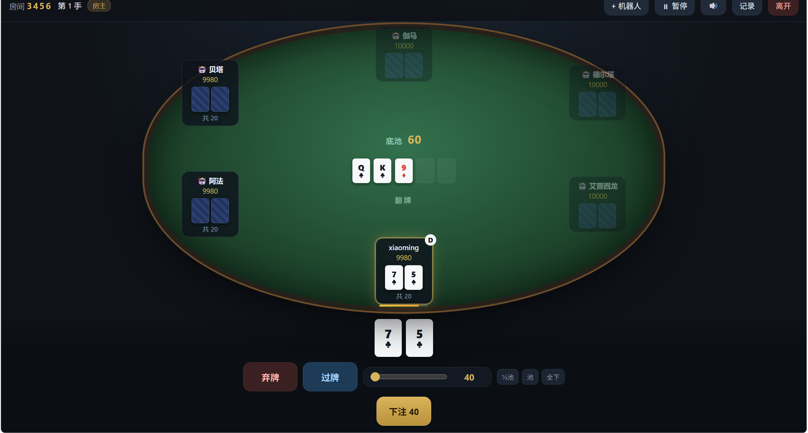
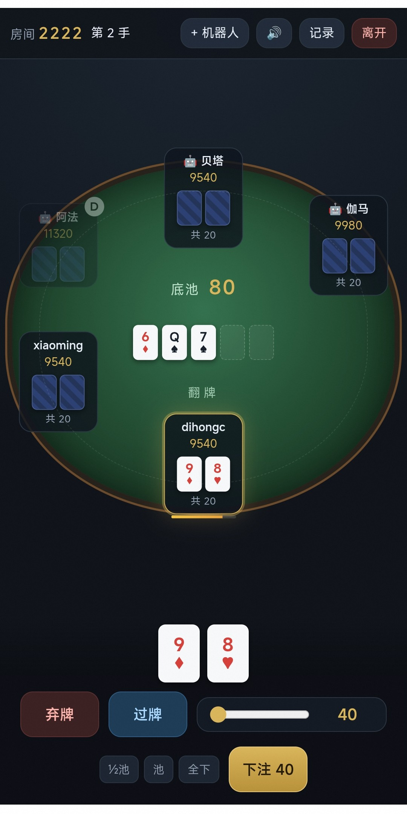

# 德州扑克 · 局域网多人联机

一个**零依赖**的网页版德州扑克。电脑上跑一个 Node 进程，几个人连同一个 WiFi 用浏览器就能开局，空位可以交给 AI 机器人。

不需要联网、不需要数据库、不需要 `npm install`。

---

## 界面预览

<p align="center">
  
  
</p>

<p align="center">
  
</p>

## 特性

- **完整规则**：无限注德州扑克，2～6 人，边池、最小加注校验、单挑特殊规则、摊牌比牌
- **局域网联机**：手机、平板、电脑，同一个 WiFi 下浏览器直接加入
- **AI 对手**：翻牌前查表、翻牌后蒙特卡洛算胜率、还会根据你的打法调整策略
- **零依赖**：只用 Node 内置模块，clone 下来就能跑
- **手机适配**：牌桌、操作按钮、提示在手机上都能正常使用
- **实时推送**：SSE 推送状态，出牌立刻同步
- **服务端发牌**：所有底牌和结算都在服务端完成，前端看不到别人的牌

## 快速开始

需要 **Node.js 18 或更高版本**（`node -v` 查看）。

### Windows

双击 `start.bat`

### macOS / Linux

```bash
node server.js
```

启动后终端会打印访问地址：

```
本机访问：  http://localhost:3000
局域网访问：http://<你的局域网IP>:3000   ← 手机连同一个 WiFi 用这个
```

浏览器打开**本机地址**，就进入了游戏。

## 怎么玩

1. 打开 `http://localhost:3000`，填昵称
2. 房间号可以自己填（4 位数字），留空则自动生成
3. 点右上角「+ 机器人」补几个 AI 对手
4. 朋友用手机打开**局域网地址**，填昵称 + 房间号，点「加入房间」
5. 人数够 2 个后，**房主点「开始游戏」**才开局

每手结束不会自动继续，由房主点「开始下一手」，方便大家看清结果。
也可以点「回到准备阶段」，回去调整人员或加机器人。

## 规则说明

- 盲注 **10 / 20**，初始筹码 **10000**
- 每个玩家 **30 秒**思考时间，超时自动过牌或弃牌
- 筹码不足一个大盲（20）的玩家出局，可重新入座并恢复 1 万筹码
- 房间里的真人全部离开后，房间自动解散

## 其他功能

| 功能 | 说明 |
|---|---|
| **暂停** | 房主在牌局进行中可以暂停，所有人的操作冻结，屏幕中央显示已暂停时长 |
| **中途加入** | 牌局进行中坐下的人，本手不参与，下一手才发牌 |
| **踢人** | 房主可以在开局前把某个真人或机器人移出房间（开局后要等这一手结束） |
| **回到准备阶段** | 一手结束后，房主可以不用直接开下一手，而是回到准备阶段重新调整人员 |
| **操作提示** | 每个人出牌时，牌桌上方弹出动作提示 + 座位气泡 + 专属音效 |
| **结算排名** | 摊牌后按牌力排序展示所有人的底牌、成牌和赢得的筹码 |
| **提示音** | 开局、过牌、跟注、加注、弃牌、倒计时各有不同音效，可开关 |

## 启动 / 停止 / 查看状态

### Windows（双击脚本）

| 脚本 | 作用 |
|---|---|
| `start.bat` | 启动服务 |
| `stop.bat` | 停止服务 |
| `status.bat` | 查看运行状态、房间、在线人数 |

### 所有平台（命令行）

```bash
node server.js          # 启动
node tools/status.js    # 查看状态
node tools/stop.js      # 停止
```

浏览器查看详细状态：**http://localhost:3000/status**

状态页每 3 秒自动刷新，显示运行时长、内存、房间列表、每个玩家的筹码和在线状态。

命令行也能直接查：

```bash
curl http://localhost:3000/api/status
```

## AI 是怎么打的

AI 分两套逻辑：**翻牌前查表**，**翻牌后用蒙特卡洛 + 对手建模**。

**翻牌前：查表**

`src/preflop-table.js` 存了 169 种起手牌对抗 1～5 个对手的胜率，
由 `tools/gen-preflop.js` 用蒙特卡洛离线算出（每组 3000 次模拟）。
翻牌前直接查表，不跑模拟，又快又准：

| 起手牌 | vs1 | vs2 | vs3 | vs4 | vs5 |
|---|---|---|---|---|---|
| AA | 85.6% | 73.1% | 63.3% | 55.9% | 49.1% |
| AKs | 65.5% | 50.4% | 41.7% | 35.2% | 30.6% |
| 72o | 35.2% | 21.1% | 13.7% | 10.7% | 9.0% |

**翻牌后：蒙特卡洛 + 对手建模**

- 随机模拟对手手牌，估算自己的胜率
- **对手建模**：记录每个玩家的入池率、加注率
  - 紧的玩家加注 → 牌很强，AI 压低自己的胜率，该弃就弃
  - 松凶玩家加注 → 可信度低，AI 继续跟
  - 样本不足 20 手时向"中性玩家"收缩，避免误判
- 结合底池赔率决定跟注 / 弃牌 / 加注
- 战绩够多后，玩家名字旁会显示 AI 判定的风格标签：`紧` / `松` / `凶`

重新生成胜率表：

```bash
node tools/gen-preflop.js
```

不是 GTO 级别，但会算赔率、会看人下菜、会诈唬，休闲局够用。

## 技术架构

```
浏览器 ──SSE──▶ 服务端状态推送
       ──POST─▶ 玩家操作
```

- 后端**零依赖**，只用 Node 内置的 `http`、`fs`、`crypto`
- 前端用 **SSE（Server-Sent Events）** 接收状态，`fetch` 提交操作，不依赖 WebSocket
- **所有发牌、底牌、结算在服务端完成**，每个玩家的状态单独序列化，别人只能看到牌背
- 数据全部在内存，重启后房间清空

## 目录结构

```
texas-holdem/
├── server.js            HTTP + SSE 服务，路由
├── src/
│   ├── cards.js         发牌 / 牌力评估（7 选 5）
│   ├── room.js          房间、下注状态机、边池结算
│   ├── bot.js           AI 决策
│   └── preflop-table.js 翻牌前胜率表（自动生成，勿手改）
├── tools/
│   ├── gen-preflop.js   重新生成胜率表
│   ├── status.js        状态查询
│   └── stop.js          停止服务
├── public/
│   ├── index.html
│   ├── style.css
│   ├── app.js           前端逻辑
│   └── status.html      服务状态页
├── test/
│   ├── run.js           单元测试
│   ├── bugs.js          核心功能回归（房号、开局、暂停、踢人）
│   ├── features.js      摊牌 / 房主 / 解散
│   ├── fullgame.js      完整对局
│   ├── sse.js           SSE 推送
│   └── diagnose.js      连打 200 手核对筹码
├── start.bat            Windows 启动
├── stop.bat
└── status.bat
```

## 测试

```bash
node test/run.js
```

覆盖：牌型判断、边池分配、平局均分、未跟注退回、连续对局筹码守恒、操作提示、
摊牌排名、房主权限、出局重入、房间解散、翻牌前查表、对手建模。

服务启动后还可以跑：

```bash
node test/features.js   # 摊牌结果 / 房主 / 解散
node test/bugs.js       # 房号 / 手动开局 / 暂停 / 中途加入 / 踢人
node test/fullgame.js   # 3 真人 + 3 AI 完整对局
node test/diagnose.js   # 连打 200 手逐手核对筹码
```

## 可调参数

在 `src/room.js` 开头：

| 常量 | 默认 | 说明 |
|---|---|---|
| `MAX_SEATS` | 6 | 座位数 |
| `SMALL_BLIND` / `BIG_BLIND` | 10 / 20 | 盲注 |
| `BUY_IN` | 10000 | 初始筹码 |
| `MIN_CHIPS_TO_PLAY` | 20 | 低于此数出局（默认等于大盲） |
| `TURN_MS` | 30000 | 每回合思考时间（毫秒） |

改完重启服务生效。

## 常见问题

**手机打不开？**

1. 确认手机和电脑连的是同一个 WiFi（手机别开流量）
2. Windows 防火墙可能拦截了：首次启动弹窗时选「允许访问」，或手动放行 Node.js 的「专用网络」
3. 电脑有多块网卡（虚拟机、VPN），依次试终端打印的每个地址

**端口被占用？**

```bash
PORT=3001 node server.js
```

**局域网 IP 变了？**

IP 是路由器分配的，重启路由或换 WiFi 可能变化。以终端打印的地址为准。

**Windows 下脚本报「不是内部或外部命令」？**

这通常是 `.bat` 文件被编辑器改成了错误的编码。确保 `.bat` 保持 ASCII / CRLF 格式。

## 部署到公网（可选）

想和异地朋友玩，可以放在国内云服务器上：

```bash
PORT=3000 node server.js
```

用 `http://公网IP:3000` 访问（不开 80/443 端口通常不需要备案），
记得在云厂商安全组放行对应端口。

## License

MIT